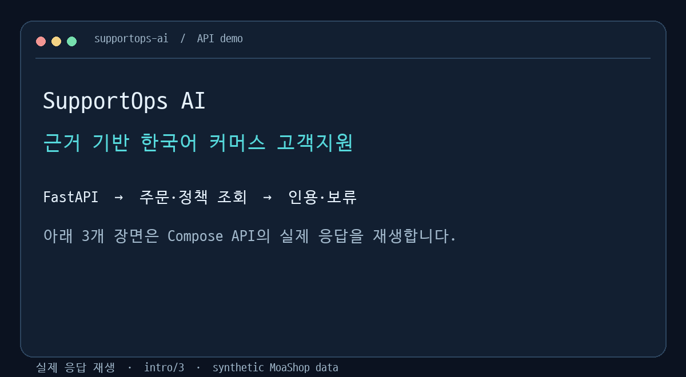
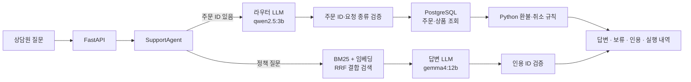

# SupportOps AI

**근거를 인용하고, 근거가 부족하면 답하지 않는 한국어 커머스 고객지원 에이전트**

가상의 쇼핑몰 MoaShop 상담원을 돕는 읽기 전용 상담 보조 시스템입니다.

- **정책 질문** ("제주도는 배송비가 더 붙어?") → 정책 문서를 검색해 답하고, 어떤 문서의 어느 섹션을 근거로 했는지 함께 보여 줍니다.
- **주문 질문** ("ORD-1008 지금 취소 가능해?") → 주문·상품을 조회한 뒤 Python 규칙으로 환불·취소 가능 여부를 판단합니다.
- **근거가 부족한 질문** → 지어내지 않고 "확인할 수 없다"고 보류합니다.

실제 환불·취소는 실행하지 않으며, 모든 데이터는 직접 설계한 합성 데이터입니다.



## 핵심 결과

평가셋 40문항(정답 정책·필수 사실·도구 호출 여부를 미리 정해 둔 고정 데이터)으로 측정했습니다.

| 항목 | 결과 |
|---|---|
| 정책 검색 Recall@5 | BM25 0.946 · 임베딩 0.919 → **하이브리드(RRF) 0.973** |
| 정책 답변: 필수 사실을 모두 포함 | **22/25** (수동 검토) |
| 정책 답변: 인용이 실제 근거와 일치 | **25/25** (수동 검토) |
| 답하면 안 되는 질문을 보류 | **15/15** |
| 주문 질문: 도구 호출·판정·보류가 모두 정답 | **11/11** |

평가셋은 개발 중에도 계속 사용했기 때문에 위 수치는 처음 보는 질문에 대한 일반화 성능이 아니라 **개발 평가 결과**입니다. 자세한 실험 과정과 실패 사례는 [실험 기록](docs/EXPERIMENTS.md)에 정리했습니다.

## 동작 구조



**정책 질문 처리**
1. 정책 Markdown 8개를 소제목 단위로 나눈 35개 청크에서 BM25와 임베딩 검색을 각각 실행합니다.
2. 두 검색의 순위를 RRF로 합쳐 상위 정책 3개를 고릅니다.
3. LLM에 근거 청크를 주고 JSON(답변, 보류 여부, 사용한 청크 ID)으로 답하게 합니다.
4. 모델이 인용한 청크 ID가 실제로 넘겨준 근거에 있는지 코드로 확인하고, 아니면 답변을 보류합니다.

**주문 질문 처리**
1. 작은 LLM이 `get_order` 도구 호출과 요청 종류(환불/취소/배송)를 제안합니다.
2. 제안된 주문 ID가 질문의 주문 ID와 다르거나 요청 종류가 이상하면 조회하지 않습니다.
3. 주문·상품을 조회하고, 환불·취소 가능 여부는 LLM이 아니라 Python 규칙이 판단합니다.
4. 답변 문구와 인용 정책도 규칙 판단 결과에 따라 코드에서 정합니다.

## 설계에서 중요하게 본 것

- **판단은 코드로.** 환불 기간(배송 완료 다음 날부터 7일), 주문제작·위생·디지털 상품 제한처럼 조건이 명확한 규칙은 LLM에 맡기지 않았습니다. 같은 입력에는 항상 같은 결과가 나오고 테스트로 검증할 수 있습니다.
- **LLM 출력은 검증 후에만 사용.** 라우터가 잘못 옮겨 적은 주문 ID로 다른 주문을 조회하지 않고, 답변 LLM이 만들어 낸 인용 ID는 거부합니다.
- **평가셋을 먼저 고정.** 검색 방식을 바꾸기 전에 평가셋을 만들고, 성능에 맞춰 평가셋이나 정책 문구를 고치지 않았습니다.
- **프레임워크는 필요할 때만.** 검색 1회 → 생성 1회 → 검증으로 끝나는 구조라 LangChain/LangGraph 없이 직접 구현했습니다.

선택 이유와 대안은 [설계 결정](docs/DESIGN.md)에 있습니다.

## 실행

Docker Compose와 [Ollama](https://ollama.com/download)가 필요합니다.

```bash
cp .env.example .env          # SUPPORTOPS_DB_PASSWORD 값을 바꿔 주세요
ollama pull qwen2.5:3b
ollama pull gemma4:12b
docker compose up -d --build

curl -sS http://127.0.0.1:8000/v1/answer \
  -H 'Content-Type: application/json' \
  -d '{"question":"ORD-1008 지금 취소 가능해?","as_of":"2026-10-05"}'
```

응답 예시: `outcome: cancel_request_allowed`, 인용 `policy_cancel_v1::01`, "실제 취소는 실행하지 않았습니다." 존재하지 않는 주문(`ORD-9999`)은 보류합니다. 첫 정책 질문은 임베딩 모델을 내려받느라 1분 이상 걸릴 수 있습니다.

API 명세, 로컬 실행, 테스트 DB 설정은 [실행·운영 가이드](docs/OPERATIONS.md)를 참고해 주세요.

## 테스트

```bash
python3 -m pip install -e '.[dev]'
python3 scripts/validate_gold_dataset.py   # 평가셋 형식·정책 ID 검증
python3 -m pytest -q                       # DB 없이 23개 통과, DB 통합 테스트 2개는 건너뜀
```

GitHub Actions CI는 PostgreSQL/pgvector를 띄워 DB 통합 테스트까지 25개를 모두 실행합니다. CI에서는 실제 LLM 대신 가짜 모델을 써서 규칙·검증 경로를 확인합니다.

## 코드 구성

| 경로 | 역할 |
|---|---|
| `src/supportops/lexical.py` | 정책 문서를 청크로 나누고 BM25로 검색 |
| `src/supportops/dense.py` | 다국어 임베딩 모델로 검색 |
| `src/supportops/hybrid.py` | 두 검색 결과를 RRF로 결합 |
| `src/supportops/vector_store.py` | pgvector 저장·검색 (메모리 검색과 결과 비교용) |
| `src/supportops/rag.py` | 근거 기반 답변 생성과 인용 검증 |
| `src/supportops/eligibility.py` | 환불·취소 가능 여부 규칙 |
| `src/supportops/agent.py` | 주문/정책 질문 분기, 도구 호출 검증, 답변 구성 |
| `src/supportops/structured.py`, `database.py` | 주문·상품 데이터 (CSV, PostgreSQL) |
| `src/supportops/api.py` | FastAPI 서비스와 구조화 로그 |
| `scripts/` | 평가 실행, DB 적재, 단일 질문 실행 |
| `reports/` | 평가 결과 원본(JSON)과 수동 검토 기록 |
| `data/raw/policies/` | 합성 정책 문서 8개 |
| `data/raw/structured/` | 합성 주문 10건·상품 10건 |
| `data/eval/gold_dataset.jsonl` | 평가셋 40문항 |

## 한계

- 오타가 있는 취소 질문(`eval_0033`)은 하이브리드 검색에서도 취소 정책을 상위 5개 안에 찾지 못합니다.
- 인용 ID가 실제 근거에 있는지는 확인하지만, 답변 문장이 근거에서 논리적으로 따라오는지까지 자동으로 보장하지는 않습니다. 실제로 교환 재고 조건, 개별 쿠폰 조건의 우선순위를 빠뜨린 답변이 3건 있었습니다.
- 로컬 `gemma4:12b`의 정책 답변은 질문당 20초대가 걸려 실제 상담 보조로 쓰기에는 느립니다.
- 수동 평가는 한 사람이 했습니다.
- 인증, 실제 결제·환불 연동, 클라우드 배포는 범위 밖입니다.
